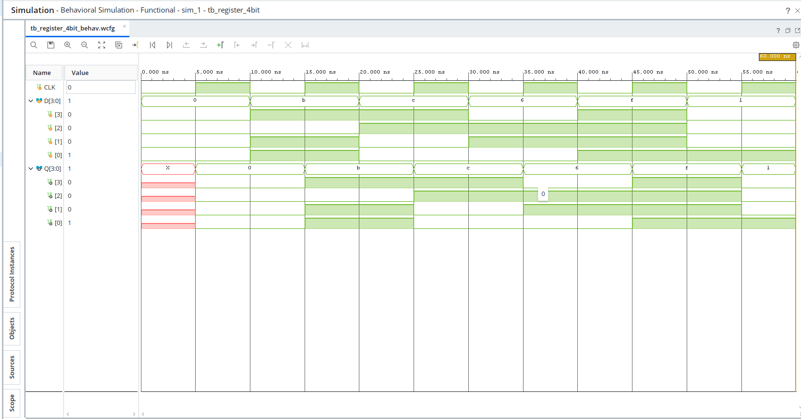

# 4-bit Register using D Flip-Flops

## Overview

This project implements a **4-bit Register** using Verilog HDL. The design is simulated using AMD Xilinx Vivado to verify data storage and clock-triggered operation.

A register is a sequential circuit consisting of multiple flip-flops used to store binary data. A 4-bit register uses four D Flip-Flops and can store 4 bits of information simultaneously.

## Functionality

The register operates according to the following conditions:

- The register captures the 4-bit input `D` at every rising edge of the clock.
- All four bits are stored simultaneously.
- The output `Q` retains its previous value between rising clock edges.
- The register can store 16 different binary combinations, from `0000` to `1111`.

## Block Description

- **Input:** `D[3:0]` - 4-bit data input.
- **Clock:** `CLK` - Controls when data is captured.
- **Output:** `Q[3:0]` - 4-bit stored data.

## Verilog Implementation

The design is implemented using an `always` block triggered by the positive edge of the clock.

```verilog
module register_4bit (
    input wire CLK,
    input wire [3:0] D,
    output reg [3:0] Q
);

    always @(posedge CLK) begin
        Q <= D;
    end

endmodule
```

## Testbench

A Verilog testbench is used to verify the functionality of the 4-bit register.

The testbench generates a clock signal with a 10 ns period and applies different 4-bit input patterns.

The following input combinations are tested:

- `0000`
- `1011`
- `1100`
- `0110`
- `1111`
- `0001`

The output is checked to ensure that all four input bits are captured correctly at the rising edge of the clock.

## Simulation

**Simulation Tool:** AMD Xilinx Vivado

**Simulation Type:** Behavioral Simulation

**Simulator:** XSim

### Simulation Waveform


The waveform demonstrates:

- Clock signal generation.
- Simultaneous capture of four input bits.
- Correct output updates at rising clock edges.
- Output retention between rising clock edges.



## Key Concepts Learned

- Sequential circuit design.
- D Flip-Flop operation.
- 4-bit data storage.
- Positive-edge-triggered logic.
- Verilog HDL implementation.
- Testbench development.
- Behavioral simulation and waveform verification.

## Tools Used

- Verilog HDL
- AMD Xilinx Vivado
- XSim Simulator