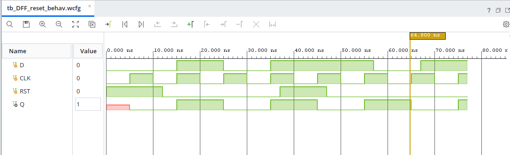

# D Flip-Flop with Synchronous Reset

## Overview

This project implements a **D Flip-Flop (DFF) with Synchronous Reset** using Verilog HDL. The design is simulated using AMD Xilinx Vivado to verify data storage and reset functionality.

A D Flip-Flop stores one bit of data and updates its output on the rising edge of the clock signal.

## Functionality

The flip-flop operates according to the following conditions:

- When `RST = 1`, the output `Q` is set to `0` at the next rising edge of the clock.
- When `RST = 0`, the input `D` is transferred to output `Q` at the rising edge of the clock.
- Changes in `D` or `RST` between rising clock edges do not immediately affect `Q`.

## Truth Table

| Clock | RST | D | Next Q |
|---|---|---|---|
| Rising Edge | 1 | X | 0 |
| Rising Edge | 0 | 0 | 0 |
| Rising Edge | 0 | 1 | 1 |
| No Rising Edge | X | X | Q (unchanged) |

`X` represents a don't-care condition.

## Verilog Implementation

The design is implemented using an `always` block triggered by the positive edge of the clock.

```verilog
module DFF_reset (
    input wire D,
    input wire CLK,
    input wire RST,
    output reg Q
);

    always @(posedge CLK) begin
        if (RST)
            Q <= 1'b0;
        else
            Q <= D;
    end

endmodule
```

## Testbench

A Verilog testbench is used to verify the functionality of the D Flip-Flop.

The testbench generates a clock signal with a 10 ns period and applies different input combinations to verify:

- Reset operation.
- Data capture when reset is inactive.
- Output retention between clock edges.
- Reset activation and release.

## Simulation

**Simulation Tool:** AMD Xilinx Vivado

**Simulation Type:** Behavioral Simulation

**Simulator:** XSim

The waveform was verified to confirm the expected output behaviour.

### Simulation Waveform

The Vivado behavioral simulation waveform is included in this repository as `tb_DFF_reset_behav.wcfg`.

The waveform demonstrates:

- Data capture at the rising edge of the clock.
- Synchronous reset operation.
- Output retention between rising clock edges.
- Correct output behaviour after reset is released.



## Key Concepts Learned

- D Flip-Flop operation.
- Positive-edge-triggered sequential logic.
- Synchronous reset.
- Verilog procedural blocks.
- Testbench development.
- Behavioral simulation and waveform verification.

## Tools Used

- Verilog HDL
- AMD Xilinx Vivado
- XSim Simulator